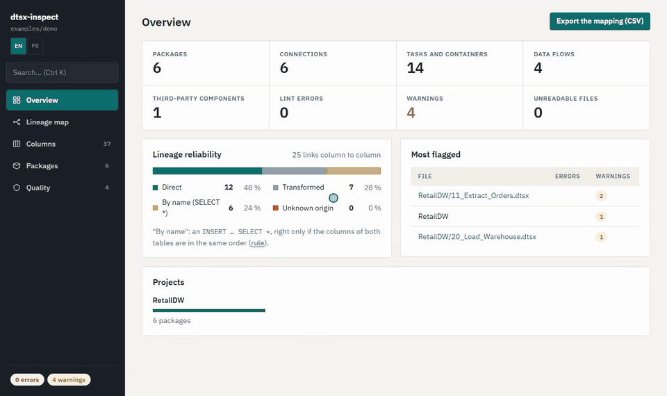

# dtsx-inspect

**English** · [Français](README.fr.md)

A fast command-line analyzer for SQL Server Integration Services (SSIS) packages, written in Rust.
Point it at a `.dtsx` file or a whole folder of SSIS projects and it tells you what the packages
contain, where the data comes from and where it goes, and which anti-patterns they carry, without
SQL Server, Visual Studio or a database connection.

- **Inventory**: connections, tasks and containers, Data Flow components, variables, parameters
  and property expressions.
- **Table lineage**: files, tables and Dynamics entities → Data Flow components and SQL tasks →
  tables, across packages (Mermaid output, or an interactive map in the HTML report).
- **Column lineage**: where a column comes from and where it goes, through Data Flows and
  `INSERT … SELECT` statements, with a source → target mapping sheet for Excel.
- **Lint**: 11 rules for common SSIS anti-patterns, each with why it matters and how to fix it.
- **Execution order** inferred from the data, **package call graph**, and **lineage diff** between
  two versions of a folder (for example before and after a server migration).
- **HTML report**: a single standalone page with search, lineage map, column pages, package
  pages and lint findings, in **English or French** (switch in the sidebar).

Secrets never leave the package: passwords are masked everywhere, connection strings are reduced
to server, database and provider, and SQL text is only shown in the HTML report's details panel,
with passwords masked.



*The HTML report on [`examples/demo`](examples/demo), a fictional SSIS project.*

## Contents

- [Download](#download)
- [Build](#build)
- [Quick start](#quick-start)
- [Commands](#commands)
- [Recipes](#recipes)
- [The HTML report](#the-html-report)
- [Lint rules](#lint-rules)
- [What is supported](#what-is-supported)
- [Development](#development)
- [License](#license)

## Download

On Windows, download `dtsx-inspect-vX.Y.Z-windows-x64.zip` from the
[latest release](https://github.com/oodinhoo/dtsx-inspect/releases/latest), unzip it and
double-click `dtsx-inspect.exe` (see [Quick start](#quick-start)). Nothing else to install.

The executable is not code-signed: on first launch, Windows SmartScreen shows "Windows protected
your PC". Click **More info**, then **Run anyway**. To check that the file was built by GitHub
Actions from this repository, with the [GitHub CLI](https://cli.github.com/):

```sh
gh attestation verify dtsx-inspect.exe -R oodinhoo/dtsx-inspect
```

On Linux and macOS, build it from source (below).

## Build

### Prerequisites

- **Rust 1.88 or later**, installed with [rustup](https://rustup.rs/).
- **Windows**: the rustup installer offers to install the *Visual Studio C++ Build Tools*
  (MSVC linker and Windows SDK); accept. Already have Rust? Update it with `rustup update`.
- **Linux / macOS**: a C toolchain (`build-essential` on Debian/Ubuntu, Xcode command line tools
  on macOS).

Check the toolchain:

```sh
rustc --version     # 1.88 or later
cargo --version
```

### Compile

```sh
git clone https://github.com/oodinhoo/dtsx-inspect
cd dtsx-inspect

cargo build --release
```

The executable is in `target/release/`:

| System | Executable |
|---|---|
| Windows | `target\release\dtsx-inspect.exe` |
| Linux / macOS | `target/release/dtsx-inspect` |

It is a single standalone file (about 10 MB): copy it anywhere, for example on a shared drive or
next to your SSIS projects. Nothing else is needed to run it.

`cargo build` without `--release` gives a faster to compile but slower debug build in
`target/debug/`.

### Install on your PATH

```sh
cargo install --path .        # copies the executable to ~/.cargo/bin
dtsx-inspect --version
```

To update after a `git pull`, run the same command again; `cargo uninstall dtsx-inspect`
removes it.

### Behind a corporate proxy (Windows)

If `cargo` fails to download crates with a certificate revocation error
(`CRYPT_E_NO_REVOCATION_CHECK`), disable the revocation check for the session:

```powershell
$env:CARGO_HTTP_CHECK_REVOKE = "false"   # PowerShell
cargo build --release
```

```sh
export CARGO_HTTP_CHECK_REVOKE=false     # bash
```

## Quick start

On Windows, **double-click** `dtsx-inspect.exe`: it asks for a folder, analyzes it and opens the
HTML report in your browser. From a terminal, run it without arguments for the same result.

```sh
dtsx-inspect inventory MyProject/            # Markdown inventory
dtsx-inspect lint MyProject/                 # anti-patterns, exit code 1 on errors
dtsx-inspect lineage MyProject/ --focus dbo.Customers > lineage.mmd
dtsx-inspect --help                          # every command
dtsx-inspect lint --help                     # options of one command
```

No SSIS project at hand? Point any command at [`examples/demo`](examples/demo): a small fictional
data warehouse (CSV file, ERP database and Dynamics CRM → staging → warehouse → CSV export) with a
few deliberate anti-patterns for the lint.

Every command takes a `.dtsx` file or a folder, walked recursively. `.conmgr` files (project
connections) and `.sql` files (database project scripts) found next to the packages are read too.
Visual Studio build copies (`obj/`, `bin/`) are skipped when the sources are present.

## Commands

| Command | Output |
|---|---|
| *(none)* | Folder picker, then the HTML report in the browser |
| `inventory <path> [--format md\|json]` | Connections, tasks, Data Flow components, parameters, variables, expressions |
| `lineage <path> [--focus <text>]` | Mermaid `flowchart` of the table lineage; `--focus` keeps only what feeds or reads the matching tables, files or entities |
| `columns <path> --of <text>` | Upstream (←) and downstream (→) chain of the matching table or file columns, for instance `--of dbo.Customers.email` |
| `mapping <path> [--out file.csv]` | Source → target mapping as CSV (`;`, UTF-8 with BOM, opens directly in Excel), one row per column link with its status |
| `lint <path>` | One line per finding, `severity[rule] file: location: message`, then the totals |
| `calls <path>` | Mermaid graph of the Execute Package tasks and the packages they run |
| `order <path>` | Markdown execution order: waves of packages, cycles, shared tables set aside, sources to load first |
| `diff <before> <after>` | Markdown comparison of the column lineage of two folders, servers aside |
| `report <path> [--out file.html]` | Standalone HTML report written to a file (to share it or publish it from a CI); without `--out`, it opens in the browser |

Searches (`--focus`, `--of`) are case-insensitive and match part of the name: `--of email`
finds every column whose full name contains `email`.

**Exit codes**: `0` on success, `1` when a file cannot be read, a search finds nothing, `lint`
finds an error, or `diff` detects a regression (a link or a package removed, or a link traced less
well). Errors go to stderr, results to stdout, so redirections only capture the results.

## Recipes

### Document a project

```sh
dtsx-inspect inventory MyProject/ > inventory.md
dtsx-inspect inventory MyProject/ --format json > inventory.json
dtsx-inspect order MyProject/ > execution-order.md
```

The JSON can be queried, for instance every third-party component:

```sh
jq '.packages[].executables[].components[]? | select(.known == false) | .class_id' inventory.json
```

```powershell
(Get-Content inventory.json -Raw | ConvertFrom-Json).packages.executables.components |
  Where-Object { -not $_.known } | Select-Object name, class_id
```

### Draw the lineage as an image

The `lineage` and `calls` outputs are [Mermaid](https://mermaid.js.org/) diagrams. Paste them
into a Markdown file on GitHub or GitLab (inside a ` ```mermaid ` block), into
[mermaid.live](https://mermaid.live), or convert them with mermaid-cli (Node.js required):

```sh
dtsx-inspect lineage MyProject/ --focus dbo.Customers > customers.mmd
npx -p @mermaid-js/mermaid-cli mmdc -i customers.mmd -o customers.svg

dtsx-inspect calls MyProject/ > calls.mmd
npx -p @mermaid-js/mermaid-cli mmdc -i calls.mmd -o calls.png
```

On a large folder, always use `--focus`: the full lineage of hundreds of packages is unreadable as
a static picture (use the HTML report instead).

### Trace a column and export the mapping

```sh
dtsx-inspect columns MyProject/ --of dbo.Customers.email
dtsx-inspect mapping MyProject/ --out mapping.csv
```

```text
Warehouse : dbo.Customers.email (srv-demo)
  ← write: DER Email.email_norm (LoadCustomers › DFT Customers)
    ← expression: FF Customers.email (LoadCustomers › DFT Customers)
      ← read: D:\demo\customers.csv.email
  → read: SRC Customers.email (Export › DFT Export)
```

Prefer `--out` for the CSV: a console redirection can re-encode it and Excel would then show
broken accents.

### Check a migration

Analyze the folder before and after the change (new server, new provider, refactored packages):

```sh
dtsx-inspect diff Packages-before/ Packages-after/ > lineage-diff.md
```

The report lists removed, new and changed column links, removed and new packages, and the servers
moved from one to the other. The exit code is `1` if a link or a package disappeared or a link is
traced less well than before.

### Lint in continuous integration

`lint` exits with `1` when it finds an error (warnings and infos do not fail the run):

```yaml
# .github/workflows/ssis-lint.yml
name: SSIS lint
on: [push, pull_request]
jobs:
  lint:
    runs-on: ubuntu-latest
    steps:
      - uses: actions/checkout@v4
      - run: cargo install --git https://github.com/oodinhoo/dtsx-inspect --locked
      - run: dtsx-inspect lint ./ssis
```

Keep a readable list of findings next to the build log:

```sh
dtsx-inspect lint MyProject/ > lint.txt; echo "exit code: $?"
```

### Windows PowerShell 5.1 and redirections

`>` in Windows PowerShell 5.1 writes UTF-16 files, which some tools cannot read. Write UTF-8
explicitly, or use PowerShell 7 (`pwsh`), whose `>` writes UTF-8:

```powershell
dtsx-inspect inventory MyProject | Out-File -Encoding utf8 inventory.md
```

## The HTML report

The report is a single HTML file, generated when the program runs without arguments and written
to the temporary folder (`%TEMP%\dtsx-inspect.html` on Windows). Use your browser's
**Save as** to keep it. Its sections:

- **Overview**: figures, lineage reliability (share of direct, transformed, by-name and unknown
  column links), most flagged packages, projects.
- **Lineage map**: interactive graph of one project or all of them. Click a block for its
  upstream and downstream chain, its properties, its SQL query and its columns.
- **Columns**: every table and file column with who writes and reads it, filters (database,
  project, package, no origin, never read, several writers), a page per column and a matrix per
  table. Export the mapping as CSV.
- **Packages**: one page per package with its flow, inventory and findings.
- **Quality**: lint findings and one card per rule.

Keyboard: `Ctrl K` or `/` to search everywhere, `F` to fit the graph, `Esc` to close the panel.

The language follows the browser (French browsers get French) and can be switched with the
**EN / FR** buttons in the sidebar. The choice is remembered.

The graph layout ([ELK](https://github.com/kieler/elkjs)), the Markdown rendering
([marked](https://github.com/markedjs/marked)) and the IBM Plex fonts load from CDNs, pinned with
Subresource Integrity hashes. Offline, everything works except the graph and the inventory
formatting.

## Lint rules

| Rule | Severity | Reports |
|---|---|---|
| `unresolved-connection` | error | Connection reference not found, or marked `:invalid` by SSDT |
| `no-fast-load` | warning | OLE DB destination inserting row by row instead of fast load |
| `obsolete-provider` | warning | Discontinued OLE DB provider (SQLNCLI, SQLOLEDB) |
| `insert-select-star` | warning | `INSERT … SELECT *` in an SQL task (columns matched by position) |
| `row-by-row-command` | warning | OLE DB Command in a Data Flow (one query per row) |
| `sort-in-data-flow` | warning | Blocking Sort component |
| `unrenamed-package` | warning | Package still named `Package` |
| `unused-columns` | warning | Source in table mode or `SELECT *` bringing unused columns into the flow |
| `default-name` | info | Task or component still named by the designer (`Data Flow Task 1`…) |
| `disabled-task` | info | Disabled task |
| `incomplete-lineage` | info | Step the lineage could not trace (SQL not parsed, query in a variable…) |

The HTML report explains each rule (why it matters, how to fix it) in its **Quality** section.

## What is supported

- SSIS 2012 and later (package format 6+), including SSIS 2012/2014 components identified by GUID.
- Data Flow sources, transformations and destinations from Microsoft; third-party components
  (KingswaySoft, Script components…) are kept as `Unknown` with their class ID, never a crash.
  KingswaySoft Dynamics 365 sources are traced to their entities, FetchXML included.
- SQL from Execute SQL tasks, OLE DB / ADO.NET sources, Lookups and OLE DB Commands, typed in
  directly, built by an expression (dashed in the lineage: design-time value) or read from a
  variable. T-SQL is parsed with [sqlparser](https://github.com/apache/datafusion-sqlparser-rs),
  with a MySQL fallback for ADO.NET sources.
- Stored procedures and views defined in `.sql` scripts (UTF-8, UTF-8 with BOM, UTF-16) are
  expanded in the lineage.

Known limits: queries read from files and KingswaySoft Dynamics destinations are not traced,
derived tables (`FROM (SELECT …) x`) end
the column lineage, and `MERGE` / `UPDATE` are traced at table level only. The `incomplete-lineage`
rule lists every step the lineage could not follow.

## Development

```sh
cargo build                                   # debug build
cargo run -- lint tests/fixtures              # run a command without installing
cargo run --release -- inventory tests/fixtures/minimal.dtsx

cargo fmt                                     # format
cargo clippy --all-targets -- -D warnings     # lint, warnings are errors
cargo test                                    # every test
cargo test --test lint                        # one test file (tests/lint.rs)
cargo test focus                              # tests whose name contains "focus"
cargo test -- --nocapture                     # show the output of the tests
```

Snapshot tests use [insta](https://insta.rs). After a deliberate change of an output, review and
accept the new snapshots:

```sh
cargo install cargo-insta    # once
cargo insta review
```

The code is organized as `parser/` (XML → model, no business logic), `lineage/` (table and column
graphs, execution order), `lint/` (one rule per file, `Rule` trait) and `render/` (Markdown,
JSON, Mermaid, CSV, HTML). Every text shown in the HTML report is written in English and gets its
French translation in `src/render/i18n.js`.

Tests use small anonymized `.dtsx` fixtures in `tests/fixtures`. Never add real customer packages
as fixtures: rename servers, databases, tables and columns, and remove connection strings.

Contributions are welcome: open an issue with an anonymized package that shows the problem, or a
pull request with a failing test first. Before submitting, `cargo fmt`, `cargo clippy` and
`cargo test` must pass. Security problems (an unmasked secret, for example) are reported
privately: see [SECURITY.md](SECURITY.md). The whole process is in
[CONTRIBUTING.md](CONTRIBUTING.md).

## License

Licensed under either of [Apache License, Version 2.0](LICENSE-APACHE) or
[MIT license](LICENSE-MIT), at your option.
